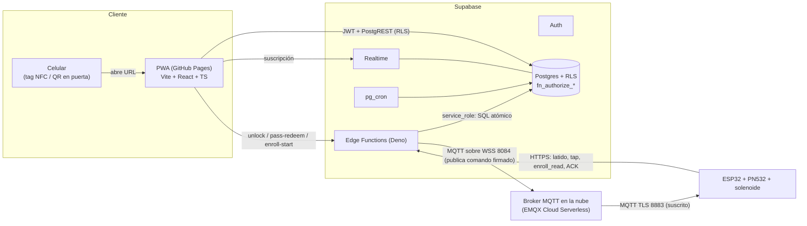
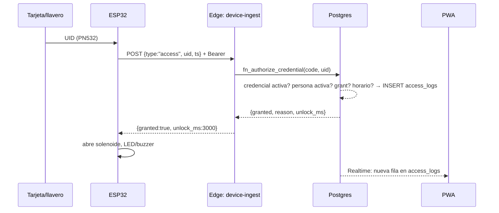
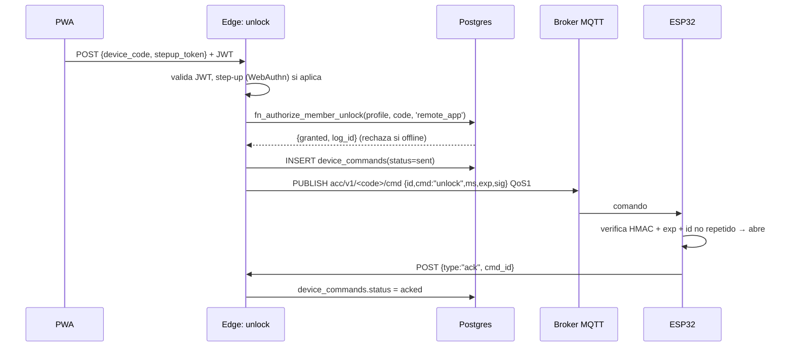
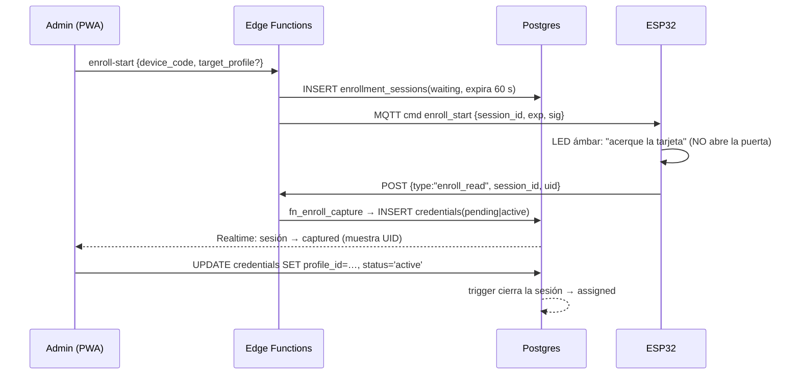
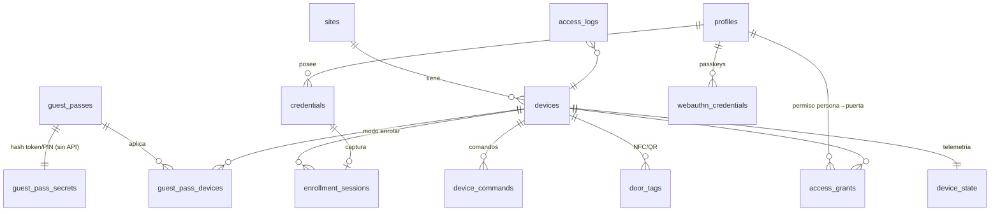

# Control de Acceso IoT — Fase 1: Arquitectura

ESP32 + PN532 + solenoide · PWA en GitHub Pages · Supabase · MQTT

## 1. Decisiones clave (resumen)

| # | Decisión | Por qué |
|---|----------|---------|
| 1 | **La PWA nunca habla con MQTT ni con el hardware.** Solo habla con Supabase (Auth + PostgREST + Realtime + Edge Functions). | GitHub Pages es estático: cualquier secreto en el JS es público. Toda decisión de acceso vive en el servidor. |
| 2 | **Dos canales con el ESP32:** MQTT para *comandos hacia abajo* (abrir, enrolar), HTTPS para *eventos hacia arriba* (tap de tarjeta, latido, ACK). | El broker gratuito no tiene webhooks hacia Supabase. Un puente siempre encendido sería un servidor más que mantener. Con HTTPS directo a Edge Functions no hay puente. |
| 3 | **El motor de decisión es SQL** (`fn_authorize_*`), invocado solo por Edge Functions con `service_role`. | Validar + consumir un uso + escribir el log ocurre en **una transacción**: no hay carreras (dos taps no superan `max_uses`). |
| 4 | **Claves de dispositivo derivadas, no almacenadas:** `HMAC(MASTER_KEY, "api\|cmd" + device_code + key_version)`. `MASTER_KEY` es un secreto de Edge Functions, no está en la base. | Una filtración de la base de datos no entrega claves de cerraduras. Rotar = subir `key_version`. |
| 5 | **Comandos MQTT firmados** (HMAC + `exp` de 10 s + id único). | No dependemos de ACL por tópico del broker gratuito; aunque alguien publique en el broker, el ESP32 rechaza lo que no esté firmado y vigente. |
| 6 | **Presencia por latido HTTPS + `pg_cron`**, no por MQTT LWT. | Supabase no ve el LWT del broker. El latido (15 s, e inmediato al cambiar el relé) marca online; un cron cada 15 s marca offline tras 45 s sin latido; Realtime avisa al panel. |
| 7 | **Hash de PIN con bcrypt + bloqueo, token de pase con 128 bits y en el fragmento `#` de la URL.** | El fragmento no se envía al servidor de GitHub Pages ni va en `Referer`; el PIN se comparte por otro mensaje. |

## 2. Componentes



### Quién habla con quién (y con qué credencial)

| Origen → Destino | Canal | Credencial |
|---|---|---|
| PWA → Supabase | HTTPS | Clave *publishable* (pública por diseño) + JWT del usuario. Protegido por **RLS**. |
| PWA (invitado) → `pass-redeem` | HTTPS | Solo la clave publishable. El token del pase + PIN son la credencial. Rate-limited. |
| Edge Function → broker | MQTT/WSS | Usuario MQTT "publisher" (secreto de Edge Functions). |
| ESP32 ← broker | MQTT/TLS 8883 | Usuario MQTT por dispositivo; solo suscripción a `acc/v1/<code>/cmd`. |
| ESP32 → Edge Function `device-ingest` | HTTPS | Cabeceras `x-device-code` + `Authorization: Bearer <api_key derivada>`. El ESP32 valida el certificado del servidor (bundle de CA, **nunca** `setInsecure()`). |

## 3. Flujos

### 3.1 Tap de tarjeta (camino crítico, objetivo < 1 s)



**Modo degradado (red caída):** el ESP32 guarda en NVS/LittleFS una *lista blanca* de UID vigentes (sincronizada en cada latido/`sync_config`), decide localmente solo por UID+vigencia (sin horarios complejos) y **encola los eventos** para subirlos con su `occurred_at` (NTP). El servidor acota esa hora a `[-7 días, ahora]`. Es opcional y configurable por puerta (*fail-secure* por defecto: sin red → solo lista blanca).

### 3.2 Apertura remota desde la PWA



El log `granted` significa *autorizado*; que la cerradura **actuó** lo confirma `device_commands.status = 'acked'`. Si el ACK no llega en 15 s, el cron lo pasa a `expired` y la PWA muestra "la puerta no respondió".

### 3.3 Modo Enrolamiento (tarjeta nueva → usuario)



Si el UID ya existe, la sesión queda `failed / uid_already_registered` y el ESP32 emite el patrón de error. Una sola sesión `waiting` por dispositivo (índice único parcial).

### 3.4 Pase de invitado (link + PIN por WhatsApp)

1. Staff crea el pase en la PWA → Edge `pass-create` → `fn_create_guest_pass`. Devuelve **una sola vez** `token` y `pin`.
2. La PWA arma el mensaje: `https://<usuario>.github.io/<repo>/#/p/<token>` y, **en un mensaje aparte**, el PIN (`wa.me/?text=…`). Dos mensajes = si interceptan uno, no sirve.
3. El invitado abre el link (sin cuenta), ve el nombre de la puerta y la vigencia, teclea el PIN y pulsa **Abrir**.
4. `pass-redeem`: rate-limit por IP y por token → `fn_authorize_pass` (verifica PIN, bloqueo tras 5 fallos/15 min, vigencia, puerta, horario, dispositivo online, **consume un uso atómicamente**) → publica el comando MQTT.

Reglas soportadas (todas en `guest_passes`): `valid_from/valid_until`, `allowed_days` (1=lun…7=dom), ventana `time_start/time_end` (admite nocturna 22:00–06:00) en la zona horaria del sitio, `max_uses` (`1` = un solo uso, `NULL` = ilimitado hasta expirar), varias puertas por pase, revocación inmediata.

> El token se guarda solo como `sha256`. Si el staff pierde el link, se **regenera** el pase (no se puede recuperar).

## 4. Catálogo de Edge Functions (se implementan en Fase 2/3)

| Función | JWT | Quién | Hace |
|---|---|---|---|
| `device-ingest` | no (auth propia) | ESP32 | `heartbeat`, `access`, `enroll_read`, `ack`, `door_event`. Autentica con clave derivada. |
| `device-sync` | no (auth propia) | ESP32 | Entrega lista blanca para modo degradado. |
| `unlock` | sí | miembro/staff | Apertura remota (+ step-up). |
| `pass-redeem` | no (anon) | invitado | Canje de pase. Rate-limited. |
| `pass-create` | sí (staff) | staff | Crea pase → token+PIN. |
| `enroll-start` / `enroll-cancel` | sí (staff) | staff | Abre/cierra sesión de enrolamiento y manda el comando. |
| `device-provision` | sí (admin) | admin | Alta de dispositivo; muestra las claves derivadas una vez. Rotación con `key_version`. |
| `admin-invite-user` | sí (admin) | admin | Invita usuarios (el registro público está desactivado). |
| `webauthn-*` | sí | miembro | Registro/verificación de passkeys para step-up biométrico. |
| `tag-verify` | sí | miembro | (Fase posterior) verifica CMAC de NTAG 424 DNA. |

Las funciones con "no" en JWT se despliegan con `--no-verify-jwt` y hacen su propia autenticación.

## 5. MQTT

- **Broker:** EMQX Cloud Serverless (plan gratuito; HiveMQ Cloud también sirve). Dan TLS 8883 (dispositivo) y WebSocket seguro (Edge Functions). *Verifica los límites vigentes del plan gratuito al crearlo; el diseño solo necesita 1 publisher + N dispositivos y tráfico mínimo.*
- **Tópicos** (`v1` permite migrar el protocolo):
  - `acc/v1/<device_code>/cmd` — servidor → ESP32, QoS 1, **sin retain**.
  - `acc/v1/<device_code>/status` — LWT/estado del ESP32 (retenido). Reservado para un futuro puente; hoy la presencia sale del latido HTTPS.
- **Comando firmado:**
  ```json
  {"v":1,"id":"6f1c…uuid","cmd":"unlock","arg":"3000","iat":1766000000,"exp":1766000010,
   "sig":"hex(HMAC-SHA256(cmd_key, id|cmd|arg|iat|exp))"}
  ```
  `arg` es siempre texto: milisegundos (`unlock`), minutos (`hold_open`), id de sesión (`enroll_*`) o vacío.
  El ESP32 exige: firma válida, hora NTP dentro de `[iat, exp]`, `id` no visto en los últimos N comandos.
- **Por qué no MQTT desde el navegador:** exigiría credenciales del broker en el JS público y se saltaría la autorización por RLS/pases.

## 6. Modelo de datos (resumen)



Archivos: [`supabase/migrations/`](../supabase/migrations/). Puntos de diseño:

- **`profiles` ≠ `auth.users`.** Una persona puede tener tarjeta sin cuenta web (`auth_user_id` nulo).
- **Roles:** `admin` (todo; acceso implícito a todas las puertas), `operator` (credenciales, permisos, pases, logs; no toca dispositivos ni roles), `user` (solo lo suyo). Roles en la tabla, **no** en `user_metadata` (editable por el usuario).
- **`access_logs` es inmutable** (trigger bloquea `UPDATE`; sin políticas de escritura). Guarda *snapshots* (`device_name`, `actor_name`, `credential_uid`) para sobrevivir a borrados. `admin_audit` registra quién cambió qué.
- **Secretos fuera de la Data API:** `guest_pass_secrets` y `rate_limits` tienen RLS activo **sin políticas** y sin `GRANT`: ni siquiera un admin puede leerlas por REST.
- **Funciones `fn_*` no ejecutables por `anon`/`authenticated`** (se revoca el `EXECUTE` que Postgres da a `PUBLIC`).
- **Realtime con RLS:** `access_logs`, `device_state`, `enrollment_sessions`, `device_commands`, `guest_passes`, `credentials`. Un `user` solo recibe sus propios eventos.
- **Presupuesto del plan gratuito:** latido a 60 s ≈ 43 k invocaciones/mes por dispositivo. Con 5 cerraduras ≈ 216 k; la cuota gratuita de Edge Functions es del orden de 500 k/mes (*verifícala*). Los latidos también evitan que Supabase pause el proyecto por inactividad.

## 7. NFC desde el celular (Android + iPhone)

**Realidad técnica que condiciona el diseño**

| Capacidad | Android (Chrome) | iPhone (Safari / PWA) |
|---|---|---|
| Web NFC (`NDEFReader`) | Sí, solo Chrome, HTTPS, con gesto del usuario, tags NDEF | **No existe** |
| Leer un tag NDEF con URL "en segundo plano" y abrirla | Sí (el sistema abre el navegador) | Sí (iPhone XS o posterior; muestra un banner y abre Safari) |
| Que el celular *emule* una tarjeta (HCE) desde la web | **No** | **No** |
| Un tag que abre la PWA ya instalada | Normalmente abre el navegador por defecto | Abre **Safari**, no la PWA instalada (almacenamiento separado) |

Conclusión: **el celular no es la tarjeta; el celular lee un tag de la puerta**. El tag solo contiene una URL, de modo que el mismo flujo sirve en Android, iPhone y con un QR impreso como respaldo. La *autorización* nunca depende del tag.

### Tres niveles (se implementan por fases)

**Nivel A — Invitado (sin cuenta):** link + PIN (§3.4). Funciona igual en iOS/Android.

**Nivel B — Miembro:** tag NFC (o QR) pegado en la puerta con `https://<usuario>.github.io/<repo>/#/d/<device_code>`.
1. Acercar el celular → se abre la PWA/Safari en la pantalla de *esa* puerta.
2. Si no hay sesión: login. **iOS:** el almacenamiento de Safari y el de la PWA instalada están separados, y Safari limita datos de sitios sin uso reciente (~7 días); por eso el login debe ser rápido: contraseña con **autorrelleno de llavero + Face ID** o *passkey*.
3. Botón **Abrir** → **step-up biométrico** (WebAuthn con autenticador de plataforma: Face ID / Touch ID / huella) → Edge `unlock` valida el `assertion`, el permiso y el horario → comando MQTT.
4. **Android con la PWA abierta:** además, Web NFC puede leer el tag dentro de la app para saltar la navegación (mejora opcional; no es requisito).

**Nivel C — Endurecido (recomendado si la puerta es de alto valor):** tag **NTAG 424 DNA** con *Secure Dynamic Messaging*. Cada toque genera una URL distinta con un CMAC y un contador; `tag-verify` valida CMAC y contador (`door_tags.last_sdm_counter`, anti-replay). Un tag estático se puede copiar con otro celular y colocarse fuera de la puerta; uno SDM, no. Cuesta unos pocos dólares. El esquema ya incluye `door_tags.kind = 'ntag424_sdm'`.

> Un tag estático sin login+biometría **no** debe abrir nada: solo prueba "intención", no presencia. Por eso el Nivel B exige sesión + step-up.

**Enrolamiento desde el celular:** se hace en el lector PN532 (modo enrolamiento), no con el celular, porque iOS no puede leer UID de tarjetas y Web NFC en Android solo lee tags NDEF.

## 8. Seguridad: amenazas y mitigaciones

| Amenaza | Mitigación |
|---|---|
| **Clonado de tarjetas MIFARE Classic / UID** (los llaveros azules y tarjetas blancas típicos lo son) | Riesgo **aceptado y documentado**: el UID es público y clonable con hardware de ~$10. Mitigar con vigencia corta, revocación inmediata, logs. Para alta seguridad: DESFire EV2/3 o NTAG 424 con autenticación (cambio de firmware/credenciales, no de esquema). |
| Fuerza bruta de PIN del pase | bcrypt, 5 intentos → bloqueo 15 min, rate-limit por IP y token, token de 128 bits. |
| Replay de comando MQTT | HMAC + `exp` 10 s + `id` único + NTP en el ESP32. |
| Filtración de la base de datos | Sin claves de dispositivo (derivadas); tokens y PIN solo como hash. |
| Escalada de privilegios web | RLS en todas las tablas; rol en tabla (no en `user_metadata`); trigger impide autopromoción; registro público desactivado. |
| Robo físico del ESP32 | Claves por dispositivo; revocar = subir `key_version` / `is_active=false`. Solenoide **fuera** del lado accesible; el ESP32 en el lado seguro. |
| Spam de logs por tokens inventados | Rate-limit antes de `fn_authorize_pass`. |
| Corte eléctrico / red | Definir *fail-secure* (cerrada) o *fail-safe* (abierta) según normativa de salida/incendio; **siempre** botón de salida mecánico/pulsador. |
| Zona horaria mal configurada | Se valida contra `pg_timezone_names`; el sitio define la zona para todos los horarios. |

**Hardware (recordatorio):** solenoide con fuente propia (12 V) conmutada por MOSFET/relé, **diodo flyback** en paralelo, no alimentar desde el pin del ESP32. PN532 por I²C o SPI.

## 9. Stack propuesto para las siguientes fases

| Capa | Elección |
|---|---|
| PWA | Vite + React + TypeScript + Tailwind, `vite-plugin-pwa`, **HashRouter** (Pages no tiene fallback SPA; además mantiene el token del pase en el fragmento), `@supabase/supabase-js`, despliegue con GitHub Actions. |
| Edge Functions | Deno/TypeScript, `npm:mqtt` sobre WSS, `@simplewebauthn/server`. |
| Firmware | ESP32 Arduino con PlatformIO; `Adafruit PN532`, `espMqttClient` (o PubSubClient), `ArduinoJson`, `mbedtls` para HMAC, `WiFiClientSecure` con bundle de CA, OTA firmado. |

## 10. Hoja de ruta

| Fase | Entregable |
|---|---|
| **1 (esta)** | Arquitectura, esquema SQL (validado), configuración inicial. |
| 2 | Edge Functions (`device-ingest`, `unlock`, `pass-*`, `enroll-*`, `device-provision`) + plantilla de firmware ESP32 (WiFi, MQTT, PN532, solenoide, latido, modo enrolamiento). |
| 3 | PWA: login, dashboard en vivo (Realtime), usuarios, credenciales + asistente de enrolamiento, pases de invitado (+ WhatsApp), logs, página de invitado `#/p/<token>`, página de puerta `#/d/<code>`. |
| 4 | WebAuthn step-up, NTAG 424 DNA, notificaciones, modo degradado completo, OTA. |
